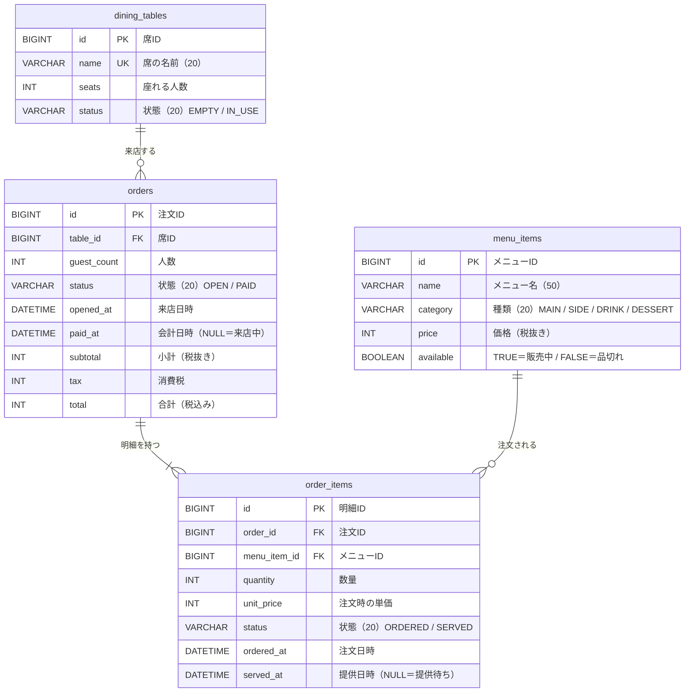

# 注文管理アプリ ER図・テーブル定義書

データベース `restaurant` には4つのテーブルがあります。
1件の注文（orders）に注文明細（order_items）が何件もぶら下がる **親子テーブル** が中心です。
定義の元は `sql/01_schema.sql` です。

## ER図

- 1つの席には、来店のたびに注文が増えていく（1対多）。来店中の注文は同時に1件まで（アプリのルール）
- 1件の注文には、明細が1件以上つく（会計できるのは明細が1件以上あるときだけ）
- 1つのメニューは、たくさんの明細から参照される

## テーブル一覧

| 論理名 | 物理名 | 役割 | 対応するJavaクラス | 初期データ |
| --- | --- | --- | --- | --- |
| メニュー | menu_items | お店のメニュー。1品1行 | `entity/MenuItem.java` | 12件（1件品切れ） |
| 席 | dining_tables | お店の席 | `entity/DiningTable.java` | 6件（2件利用中） |
| 注文 | orders | 来店1回分（伝票1枚）。会計すると金額が記録される | `entity/CustomerOrder.java` | 4件（会計済2・来店中2） |
| 注文明細 | order_items | 注文した料理1行ずつ | `entity/OrderItem.java` | 9件（提供待ち3） |

## menu_items（メニュー）

| No | 論理名 | 物理名 | データ型 | NULL | キー | 初期値 | Javaフィールド | 説明 |
| --- | --- | --- | --- | --- | --- | --- | --- | --- |
| 1 | メニューID | id | BIGINT | 不可 | PK | 自動採番 | `id` (Long) | |
| 2 | メニュー名 | name | VARCHAR(50) | 不可 | | | `name` (String) | |
| 3 | 種類 | category | VARCHAR(20) | 不可 | | | `category` (MenuCategory) | MAIN / SIDE / DRINK / DESSERT |
| 4 | 価格 | price | INT | 不可 | | | `price` (Integer) | 税抜き・円 |
| 5 | 販売中 | available | BOOLEAN | 不可 | | TRUE | `available` (Boolean) | FALSE＝品切れ |

## dining_tables（席）

| No | 論理名 | 物理名 | データ型 | NULL | キー | 初期値 | Javaフィールド | 説明 |
| --- | --- | --- | --- | --- | --- | --- | --- | --- |
| 1 | 席ID | id | BIGINT | 不可 | PK | 自動採番 | `id` (Long) | |
| 2 | 席の名前 | name | VARCHAR(20) | 不可 | UK | | `name` (String) | 例：A1。重複不可 |
| 3 | 座れる人数 | seats | INT | 不可 | | | `seats` (Integer) | 来店受付の人数の上限 |
| 4 | 状態 | status | VARCHAR(20) | 不可 | | 'EMPTY' | `status` (TableStatus) | EMPTY：空席 / IN_USE：利用中 |

## orders（注文）

| No | 論理名 | 物理名 | データ型 | NULL | キー | 初期値 | Javaフィールド | 説明 |
| --- | --- | --- | --- | --- | --- | --- | --- | --- |
| 1 | 注文ID | id | BIGINT | 不可 | PK | 自動採番 | `id` (Long) | |
| 2 | 席ID | table_id | BIGINT | 不可 | FK | | `diningTable` (DiningTable) | dining_tables.id を参照 |
| 3 | 人数 | guest_count | INT | 不可 | | | `guestCount` (Integer) | |
| 4 | 状態 | status | VARCHAR(20) | 不可 | | 'OPEN' | `status` (OrderStatus) | OPEN：来店中 / PAID：会計済 |
| 5 | 来店日時 | opened_at | DATETIME | 不可 | | | `openedAt` (LocalDateTime) | |
| 6 | 会計日時 | paid_at | DATETIME | 可 | | | `paidAt` (LocalDateTime) | 来店中は NULL |
| 7 | 小計 | subtotal | INT | 可 | | | `subtotal` (Integer) | 税抜き。会計時に記録 |
| 8 | 消費税 | tax | INT | 可 | | | `tax` (Integer) | 小計の10%、1円未満切り捨て。会計時に記録 |
| 9 | 合計 | total | INT | 可 | | | `total` (Integer) | 税込み。会計時に記録 |

## order_items（注文明細）

| No | 論理名 | 物理名 | データ型 | NULL | キー | 初期値 | Javaフィールド | 説明 |
| --- | --- | --- | --- | --- | --- | --- | --- | --- |
| 1 | 明細ID | id | BIGINT | 不可 | PK | 自動採番 | `id` (Long) | |
| 2 | 注文ID | order_id | BIGINT | 不可 | FK | | `customerOrder` (CustomerOrder) | orders.id を参照 |
| 3 | メニューID | menu_item_id | BIGINT | 不可 | FK | | `menuItem` (MenuItem) | menu_items.id を参照 |
| 4 | 数量 | quantity | INT | 不可 | | | `quantity` (Integer) | 1〜10 |
| 5 | 単価 | unit_price | INT | 不可 | | | `unitPrice` (Integer) | **注文したときの**メニューの価格 |
| 6 | 状態 | status | VARCHAR(20) | 不可 | | 'ORDERED' | `status` (OrderItemStatus) | ORDERED：注文済 / SERVED：提供済 |
| 7 | 注文日時 | ordered_at | DATETIME | 不可 | | | `orderedAt` (LocalDateTime) | |
| 8 | 提供日時 | served_at | DATETIME | 可 | | | `servedAt` (LocalDateTime) | 提供待ちは NULL |

## 制約と値の決まり

| 制約名 | 種類 | テーブル.列 | 意味 |
| --- | --- | --- | --- |
| uk_dining_tables_name | 一意 | dining_tables.name | 同じ名前の席は作れない |
| fk_orders_table | 外部キー | orders.table_id → dining_tables.id | 存在しない席には来店できない |
| fk_order_items_order | 外部キー | order_items.order_id → orders.id | 明細は必ずどれかの注文に属する |
| fk_order_items_menu | 外部キー | order_items.menu_item_id → menu_items.id | 注文されたことのあるメニューは削除できない（品切れで管理する） |

- **unit_price を明細に持つ理由**：メニューの価格を後で変えても、過去の注文の金額が変わらないようにするため（初期データの「昨日のカレーライス」は800円、今のメニューは850円）
- **subtotal・tax・total を注文に持つ理由**：会計したときの金額を記録として残すため。来店中は NULL
- **提供待ち**：order_items.status が ORDERED の行。キッチン画面に出る
- **1回の数量は1〜10・会計は提供待ちがないときだけ**：テーブルの制約ではなく、アプリ（`OrderService`）でたしかめるルール
